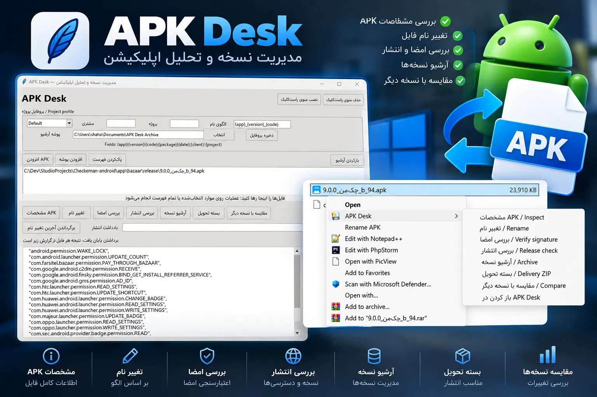

# APK Desk

A simple Windows app to manage Android APK files from your right-click menu.



[Download for Windows](https://github.com/shahabsaalami/APK-Desk/releases/latest)

## Features

- View app details and permissions.
- Rename APKs using the app name, version, or your own pattern.
- Verify APK signatures and check for common release issues.
- Compare two APK versions.
- Archive releases and create a delivery ZIP with notes and checksums.
- Process multiple files and save settings for each project.
- Undo the last rename.
- Install APKs on a connected phone or emulator from the app or right-click menu.

## Get started

1. Download the Windows ZIP from [Releases](https://github.com/shahabsaalami/APK-Desk/releases/latest).
2. Extract it to a folder you plan to keep.
3. Run `APKDesk.exe` and click **نصب منوی راست‌کلیک** to add the right-click menu.
4. Right-click an APK and choose **APK Desk**. On Windows 11, check **Show more options**.

You can also drag APK files into the app. To customize filenames, set your project details and naming pattern, then save the profile.

**No Python installation is needed for the EXE.** APK inspection and signature verification require Android SDK Build-Tools (`aapt` and `apksigner.jar`) and Java. Add `aapt` and `java` to your PATH.

## Install on your phone

1. Install [Android SDK Platform-Tools](https://developer.android.com/tools/releases/platform-tools) and add `adb` to your PATH (or set `ANDROID_HOME` to your SDK folder).
2. Enable **USB debugging**, connect your phone, and allow the connection on its screen. An emulator or a paired wireless ADB device also works.
3. Right-click an APK and choose **APK Desk → نصب روی گوشی / Install APK**.

If more than one device is connected, choose the target device. You can also install multiple APK files from the main window. Existing apps are updated while keeping their data; Android may reject an update if its signature or version is incompatible. Installation itself only needs ADB, not Java or Build-Tools.

## Run from source

With Python 3.13 installed:

```powershell
pip install -r requirements.txt
python apk_desk.py
```

To build the Windows EXE:

```powershell
.\Build.ps1
```

## راهنمای فارسی

APK Desk یک ابزار سادهٔ ویندوزی برای مدیریت فایل‌های APK از منوی راست‌کلیک است.

نسخهٔ ZIP را از [بخش دانلود](https://github.com/shahabsaalami/APK-Desk/releases/latest) بگیر، استخراج کن و `APKDesk.exe` را اجرا کن. دکمهٔ **نصب منوی راست‌کلیک** را بزن؛ بعد روی هر APK راست‌کلیک کن و **APK Desk** را انتخاب کن. در ویندوز ۱۱ ممکن است منو زیر **Show more options** باشد.

می‌توانی مشخصات و امضای فایل را بررسی کنی، نامش را تغییر بدهی، نسخه‌ها را مقایسه کنی یا آرشیو و بستهٔ تحویل بسازی. برای تنظیم نام‌گذاری، اطلاعات پروژه و الگوی نام را وارد کن و **ذخیره پروفایل** را بزن.

نسخهٔ اجرایی به نصب Python نیاز ندارد؛ برای بررسی APK و امضا، Android SDK Build-Tools و Java لازم است. اگر پوشهٔ برنامه را جابه‌جا کردی، نصب منوی راست‌کلیک را دوباره انجام بده.

برای نصب روی گوشی، ADB را از Android SDK Platform-Tools در دسترس قرار بده، **USB debugging** را فعال کن و اجازهٔ اتصال را روی گوشی تأیید کن. بعد از راست‌کلیک روی APK، گزینهٔ **نصب روی گوشی / Install APK** را بزن. اگر چند دستگاه وصل باشند، دستگاه مقصد را انتخاب می‌کنی. پس از به‌روزرسانی برنامه، دکمهٔ **نصب منوی راست‌کلیک** را دوباره بزن تا گزینهٔ جدید اضافه شود.
